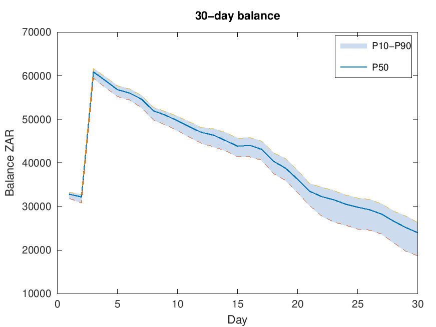
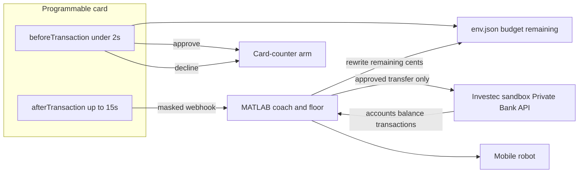
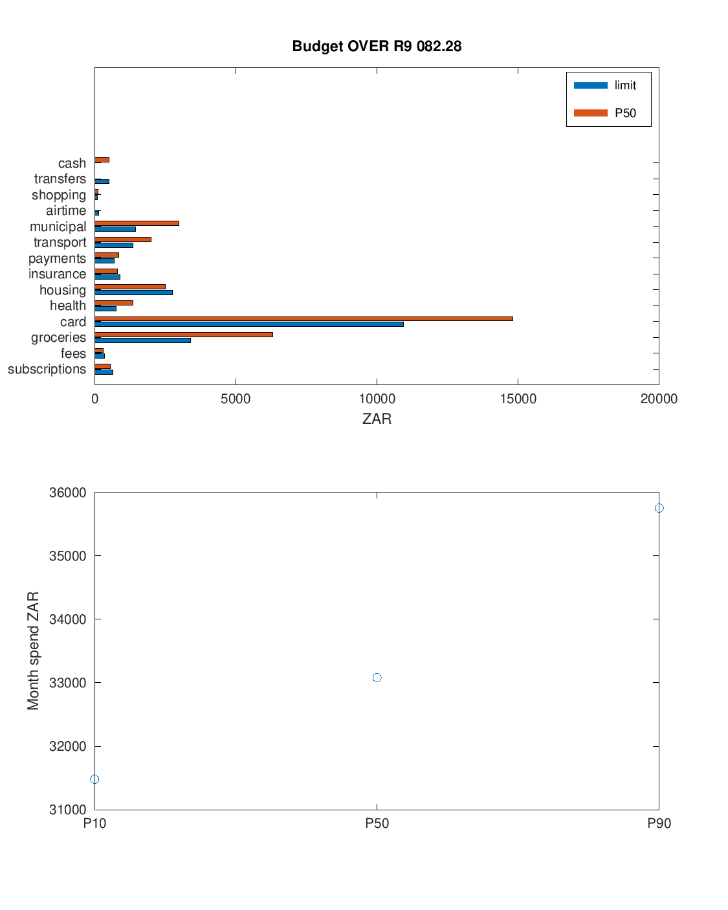
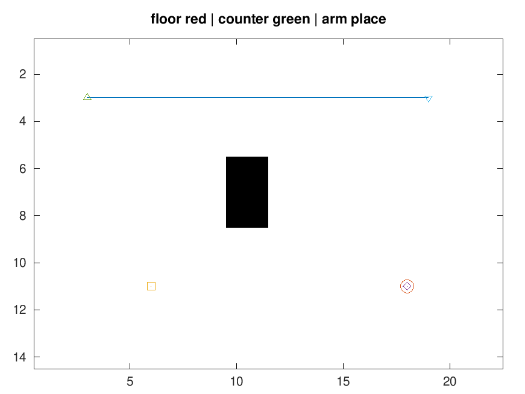
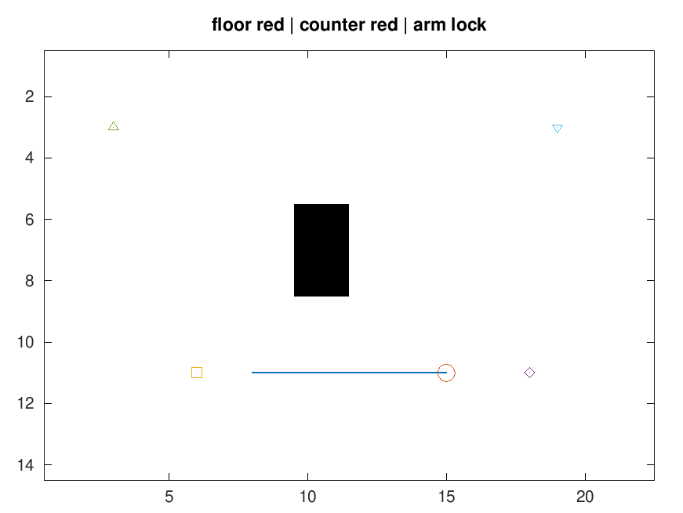

# The Vault

When money moves in Investec, a robot moves it on the floor.

The Vault is a MATLAB/Simulink money floor for Investec's Q4 2026 Programmable Banking bounty, [Make Money Move](https://investec.gitbook.io/programmable-banking-community-wiki/get-building/build-events/q4-2026-bounty-challenge-or-make-money-move) (submit by 23:59 SAST on 10 January 2027). Each account is a vault. A mobile robot carries gold bars between the current-account vault, the savings vault, and the exit. A 4-joint arm at the card counter loads bars when a card purchase is approved and locks the counter when it is declined. A monthly budget coach watches the Private Bank Account and turns the floor green, amber, or red.

This repository is the first working slice: live sandbox reads, an offline snapshot of that same sandbox, card rules, the budget coach, and a scripted floor. The physical parts list is in [docs/parts-list.md](docs/parts-list.md).



The salary-like credit (about R29,733) lands a few days out, then the balance drifts down. The floor colour comes from the budget verdict, not from this chart.

## The problem

A card authorisation has two seconds. It cannot wait for MATLAB. A transfer is irreversible, so a robot or a button must not be able to send one. And the sandbox history is only mid-August to 16 November 2026, which is enough to see salary and debit orders but short for a monthly coach.

## How money moves



1. MATLAB reads the Private Bank Account, learns habits, and writes per-category remaining cents into `card-code/env.json`.
2. `beforeTransaction` reads that file from `process.env`. It does not call MATLAB or the network. Over-budget categories return `false`.
3. `afterTransaction` / `afterDecline` POST a masked event. The account number is reduced to its last four digits.
4. A transfer is printed as a review first. `transfermultiple` runs only after the decision verb is exactly `APPROVE`. Against the shared public sandbox it is still held unless `VAULT_ALLOW_LIVE_TRANSFER=1`.

Floor lights follow the budget verdict: **UNDER green**, **ON amber**, **OVER red**. A separate beacon turns amber when the 30-day P50 balance would fall through the runway buffer. On this snapshot the budget is over and the runway is not short, so the floor is red and the beacon stays off.

## Budget coach

The coach is part of this slice, not a later idea.

It pulls posted transactions for an explicit `fromDate` and `toDate`. There is no category field on the feed, so categories come from an editable table in [shared/merchant-rules.json](shared/merchant-rules.json): a description keyword wins, otherwise the Investec `transactionType` (`CardPurchases`, `DebitOrders`, `Deposits`, `FeesAndInterest`, `ATMWithdrawals`, `VASTransactions`, `FasterPay`, `OnlineBankingPayments`) supplies the bucket.

Recurring items are matched on a fuzzy stem. `VODACOM 0397` and `VODACOM 0401` share `vodacom`. `STANCOM ...joe.smith` stays separate from the smaller weekly STANCOM payment. A stem is recurring when it appears in at least two distinct baseline months, the amounts sit within 15% or R5, and the day-of-month range is at most 7.

The sandbox window is 11 August to 16 November 2026 (264 posted transactions). August starts on the 11th and November is still open, so the baseline medians use complete months only. When that is fewer than six months, the coach clones September and October backward to April–July, perturbs card and payment amounts, and leaves salary, debit orders, fees, and airtime amounts intact so the same stems still match. Every report says which months are real and which are synthetic. Turn the copies off with `vault_demo('backfill', false)` or `VAULT_BACKFILL=0`.

During November it projects the rest of the month with a seeded Monte Carlo draw (P10 / P50 / P90), month-to-date actuals, and the recurring items not yet posted. The verdict line is one of:

- `BUDGET OVER by ...` plus the categories driving it and the projected crossover date
- `BUDGET UNDER by ...` plus a savings sweep that keeps the P90 path inside the budget and still requires approval
- `BUDGET ON` when the surplus is inside the band (the larger of R100 and 5%)

Suggested category limits are the baseline median plus 10%, rounded up to R50. Edit [matlab/fixtures/budget.user.json](matlab/fixtures/budget.user.json) to replace any limit. A user value wins.

On the 16 November 2026 snapshot, with back-fill on, the scripted demo prints an OVER verdict. The large unclassified card bucket and groceries are the main drivers. Shopping is already tight, so a R2,500 Takealot swipe is declined while a small swipe in a category that still has cents is approved. The 30-day fan pre-stages bars before a heavy upcoming day. Weekday discretionary spend is higher than weekend spend in this particular history (ratio about 0.72); the multiplier is measured, not assumed.



## Run it

Requirements: MATLAB R2021b or newer for the live path (`webread` / `webwrite`). Robotics System Toolbox is optional; the arm also runs on plain DH kinematics. Octave 8 is enough for the logic tests and the scripted demo. Node.js 20+ runs the card harness.

### Sandbox (primary)

The public sandbox `client_id`, `client_secret`, and `x-api-key` are on the Private Bank API page. Copy them into your environment. Do not commit them, even though Investec publishes them for the sandbox.

- https://developer.investec.com/api-reference/SA%20PB%20Account%20Information (Sandbox credentials)
- https://developer.investec.com/individuals (Use the Sandbox)
- Auth shape: https://developer.investec.com/api-reference/SA%20Open%20API%20-%20Authorization

```bash
export INVESTEC_CLIENT_ID="paste-from-the-docs"
export INVESTEC_CLIENT_SECRET="paste-from-the-docs"
export INVESTEC_API_KEY="paste-from-the-docs"
export INVESTEC_BASE_URL="https://openapisandbox.investec.com"
# optional: VAULT_ALLOW_LIVE_TRANSFER=1   # actually POST transfermultiple
```

```matlab
cd('matlab')
vault_demo
```

With those three variables set and `VAULT_MODE` unset, the client uses the sandbox. It always sends `fromDate=2020-01-01` and `toDate=2026-11-16` (or `VAULT_AS_OF`). Leaving `fromDate` off makes the sandbox apply its own lookback, which drops the 11 August card purchase. The token is cached in memory until about 60 seconds before the 1799-second expiry.

`GET /za/v1/cards` returns 403 with this token (no `cards` scope). The demo records that and continues. Pending transactions are loaded for the Private Bank Account and ignored, with a warning, when another account returns HTTP 500.

A refresh of the committed snapshot, still without writing secrets to disk:

```bash
python3 tools/refresh_sandbox_fixture.py
```

### Mock (CI and laptops without credentials)

```matlab
vault_demo('mode', 'mock')
vault_demo('mode', 'mock', 'backfill', false)
vault_demo('mode', 'mock', 'stress', true, 'plots', false)
```

Or `VAULT_MODE=mock`. The fixture under `matlab/fixtures/` is a 16 November 2026 pull of the public sandbox: 8 accounts, 264 Private Bank Account transactions, balances, and the three pending debits (Amazon, MRP Home, YouTube). Long digit runs inside descriptions were masked before commit. Account numbers are still in the fixture so the mock matches the API; every printed line masks them.

Figures land in `matlab/output/` (gitignored). The copies in `docs/images/` are from a mock run of this slice.





### Card harness

The card file is `card-code/main.js` plus `card-code/env.example.json`. Publish it from the Investec Online IDE (`main.js` and `env.json`). The sandbox cards API cannot simulate it.

```bash
cd card-code
npm test
node tools/decide.js --cents 250000 --merchant "Takealot"
node tools/simulate.js --cents 20000 --merchant "Woolworths Sandton"
node tools/stress.js --days 30
```

`decide.js` exits 0 on approve and 2 on decline. Amounts are cents. `beforeTransaction` has no `fetch`. `afterTransaction` posts to `VAULT_WEBHOOK_URL` when that variable is set.

### Tests

```bash
cd card-code && npm test
octave --no-gui --quiet --eval "cd('matlab/tests'); run_all"
```

GitHub Actions runs both, plus gitleaks. See `.github/workflows/ci.yml`.

## Layout

| Path | What it is |
| --- | --- |
| `matlab/+vault/` | Client, coach, planner, arm, demo |
| `matlab/vault_demo.m` | Entry script |
| `matlab/fixtures/` | Sandbox snapshot used in mock mode |
| `shared/merchant-rules.json` | Editable keyword and transactionType table |
| `card-code/main.js` | `beforeTransaction` / `afterTransaction` / `afterDecline` |
| `firmware/` | ESP32 sketch and wiring for the physical build |
| `docs/parts-list.md` | ZAR parts list |
| `KNOWLEDGE.md` | What the sandbox actually does |

## Safety

- Secrets stay in the environment or in `config/local.json`, which is gitignored. `.env.example` and `config/local.example.json` have empty placeholders.
- Logs and the transfer review show `****` plus the last four digits. Bearer tokens and runs of 8 or more digits are scrubbed from errors.
- 25-digit account ids are quoted before `jsondecode`, because a double cannot hold them.
- No transfer function will call the API without `decideApproval(..., 'APPROVE', ...)`. A forged `approved: true` flag is rejected.
- The shared sandbox is not mutated unless `VAULT_ALLOW_LIVE_TRANSFER=1`.
- The arm and the robots are 5 V hobby parts. Do not connect this to an ATM, a payment terminal, or mains.

## Roadmap

- Second physical robot and a reservation table on the ESP32s (the planner already keeps two robots out of the same cell).
- Simulink 3D Animation / Unreal co-simulation on top of the same joint and path commands. `vault.tryRigidBodyTree` builds a toolbox arm when Robotics System Toolbox is installed; this slice animates the DH model either way.
- A small webhook inbox so `afterTransaction` drives the floor without the scripted storyboard.
- `paymultiple` behind the same approval gate. It is intentionally not called.
- A cards-scoped credential, if Investec opens sandbox card simulation. Until then the Node harness and the IDE are the card path.

## Licence

MIT. See [LICENSE](LICENSE).
